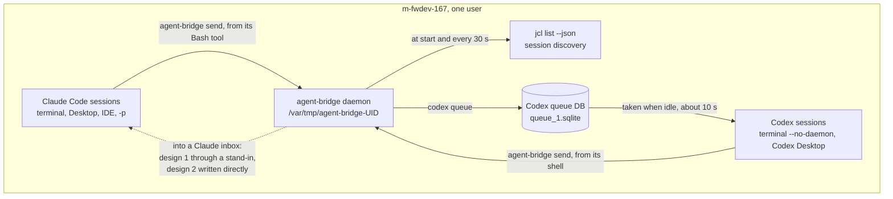
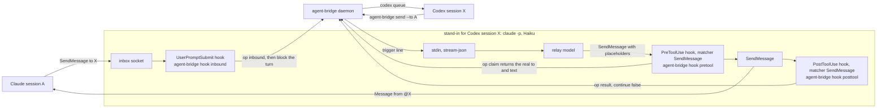
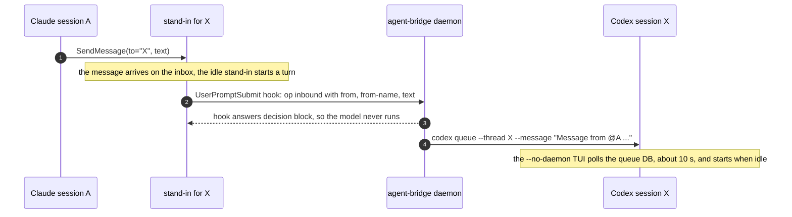
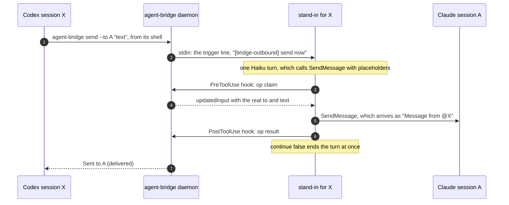
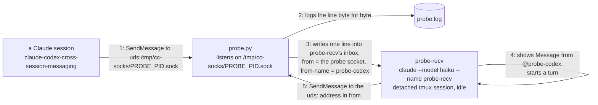
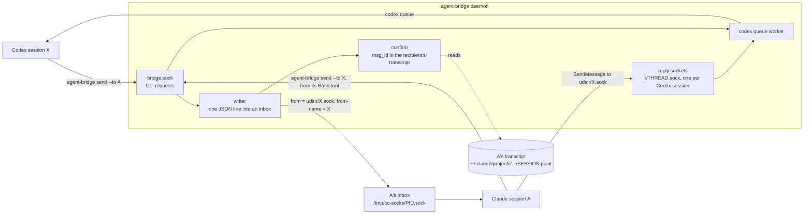
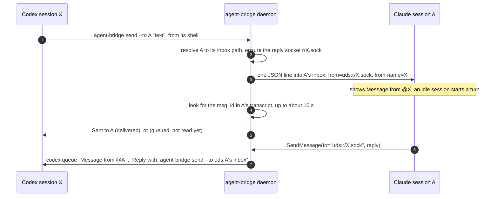
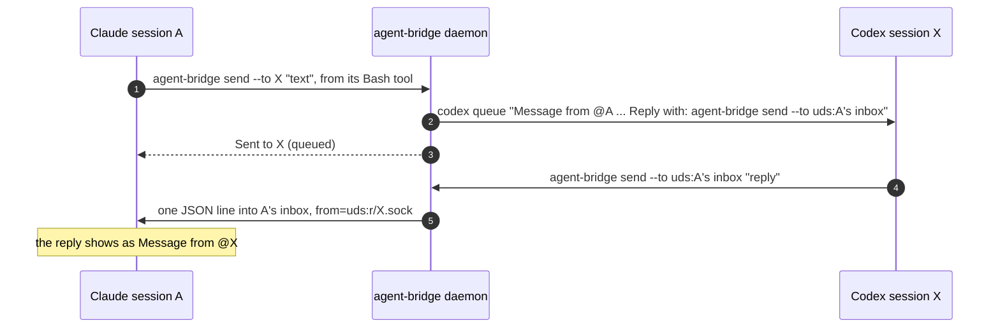
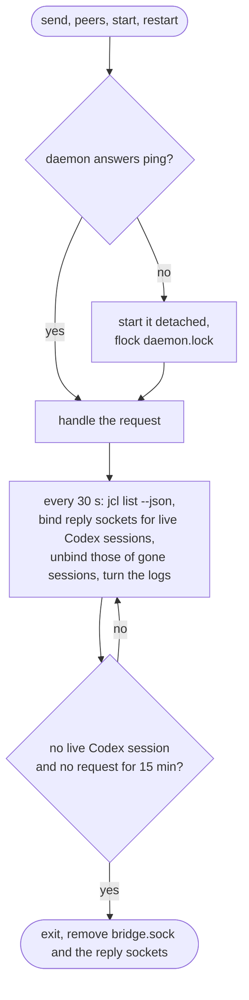

# agent-bridge: messaging between Claude Code and Codex sessions

The design record for [`nv-tools/agent-bridge`](../nv-tools/agent-bridge). It covers:

- why the tool exists;
- how the first design, **stand-ins**, works;
- why that design is being replaced;
- the experiment that settled the question;
- the second design, **direct inbox delivery**, that replaces it.

| | |
|---|---|
| Host | m-fwdev-167, one user |
| Versions | Claude Code 2.1.283, Codex CLI 0.157.1 |
| Design 1: stand-ins | Implemented 2026-10-10 to 2026-10-12 and committed as `6a16116` ("add agent-bridge"). Its final state is kept on the local branch `agent-bridge-design1` (`3719b03`); [§4.8](#48-restoring-design-1) restores it in one command. |
| Design 2: direct inbox delivery | Adopted 2026-10-12 and live since 15:02 that day. The steps and their state are in [§7.12](#712-implementation-steps), the verification in [§7.13](#713-verification-on-the-host). Not yet committed. |
| Files involved | `nv-tools/agent-bridge`, `nv-tools/jcl` (`jcl list`, `jcl bridge`), `completion/agent-bridge_completion.bash`, `completion/jcl_completion.bash`, `README.md` (the agent-bridge section), `assets/codex/AGENTS.md`, `assets/claude/CLAUDE.md`, `track-files/bashrc` (the `codex` wrapper), `tests/test_agent_bridge.py`, `tests/test_jcl.py` |

Contents

1. [Requirements](#1-requirements)
2. [What each agent offers natively](#2-what-each-agent-offers-natively)
3. [The architecture both designs share](#3-the-architecture-both-designs-share)
4. [Design 1: stand-ins](#4-design-1-stand-ins)
5. [Why the stand-ins are being dropped](#5-why-the-stand-ins-are-being-dropped)
6. [Experiment: writing into a Claude inbox (2026-10-12)](#6-experiment-writing-into-a-claude-inbox-2026-10-12)
7. [Design 2: direct inbox delivery](#7-design-2-direct-inbox-delivery)
8. [The two designs side by side](#8-the-two-designs-side-by-side)
9. [Alternatives considered and rejected](#9-alternatives-considered-and-rejected)
10. [Decision log](#10-decision-log)
- [Appendix A: wire formats](#appendix-a-wire-formats)
- [Appendix B: glossary](#appendix-b-glossary)

---

## 1. Requirements

As Peter set them on 2026-10-09 and 2026-10-10:

- **Addressing**: every Claude Code session and every Codex session on the host can message every
  other one by **session name**.
  - Session ids work too. They are a convenience for a person who tells one session to talk to
    another, for example "talk to 01a11eb2". Internally the name stays the address.
  - An id can be the SESSION ID column of `jcl list`, or its first 8 or more characters.
- **What the receiver sees**: a message looks the way Claude's native cross-session messages
  look, `Message from @<name>`. The receiver can tell that it came from another agent and not
  from the user.
- **Replies** work the way Claude sessions already reply to each other.
- **Upgrades**: it keeps working after Claude Code or Codex upgrades.
- **Out of scope**: Claude-to-Claude messaging stays on Claude's own mechanism. Nothing is
  relayed there.

Constraints added from 2026-10-10 to 2026-10-12:

- jcl never starts the bridge on its own.
- The bridge can be controlled through `jcl bridge …` as well, with every command except `send`.
  `send` is for agents.
- Run files live on local disk under `/var/tmp`.
- Logs are bounded: 256 KB per log, plus one `.1` generation.
- No needless daemon restarts. In design 1 a restart changes the stand-ins' reply addresses.

## 2. What each agent offers natively

### 2.1 Claude Code (2.1.283)

From the [cross-session messaging docs](https://code.claude.com/docs/en/cross-session-messaging)
and the binary.

**Tools and transport**

- Claude finds peers with `ListAgents` (`/list-agents`) and sends with `SendMessage`.
- A message to a session on the same machine goes over that session's **inbox socket**. This
  is a Unix socket at `/tmp/cc-socks/<pid>.sock`, mode 0600, in a directory with mode 0700.

**Discovery**

- A session is listed only when it binds an inbox.
- The listing is read from the session registry, `~/.claude/sessions/<pid>.json`. The fields
  include `messagingSocketPath`, `name`, `sessionId`, `kind`, `procStart` and `pidDomain`.
- The registry format is internal and not documented.

**Delivery**

- A busy receiver reads the message between tool calls.
- An idle receiver starts a new turn with the message.

**Inbound controls**

- The `crossSessionInbound` setting takes `accept`, `hold` or `refuse`.
- When no value is set, the result depends on the permission modes of the two sessions:
  - A receiver that prompts for permissions (default, `auto`, `acceptEdits`, `dontAsk`)
    delivers every message, unless the sender says it bypasses permissions.
  - A receiver in `bypassPermissions` holds every message for the user's approval, unless the
    sender says it bypasses permissions too.
- A held message waits for approval until `dialogExpiry`, five minutes by default, and is then
  dropped.

**Headless workers**

- A long-running `claude -p --input-format stream-json` session binds an inbox the same way an
  interactive session does. It appears in the listing and starts a turn when a message arrives.
- Setting `crossSessionInbound: accept` in its `--settings` lets it take messages unattended.
- A session in bare mode binds no inbox.

**The inbox socket section of the docs**

The docs have a section on the inbox socket "when you want a script or hook to post into a
session". It says:

- the socket path is shown in `/status` (`Peer address`) and exported as
  `$CLAUDE_CODE_MESSAGING_SOCKET`;
- a connection may start with an auth line, `{"type":"auth","token":"<$CLAUDE_CODE_MESSAGING_TOKEN>"}`;
  the line is optional on Linux;
- a connection must send a complete line within 30 s;
- messages posted on the socket go through the same inbound controls as any peer message;
  messages from the session's own child processes are let through by default.

Claude Code's own `--debug` log prints an example of posting when a session starts: an optional
auth line, then `{"type":"user","message":{"role":"user","content":"hello"}}`, piped into the
socket with `socat`. That minimal line carries no sender name and no reply address.

**The format of the message line `SendMessage` writes, which carries both, is not documented.**
[§6](#6-experiment-writing-into-a-claude-inbox-2026-10-12) captures it.

**Limits**

- plain text only;
- about a million characters per message;
- rapid bursts are refused;
- repeated messages are rate-limited per sender;
- at most 50 messages are queued.

**Channels**

[Channels](https://code.claude.com/docs/en/channels) are the other documented way in: an MCP
server pushes events into a session.

- They are blocked for claude.ai Team and Enterprise until an Owner sets `channelsEnabled`.
- The org settings cached on this host have no such key, so channels are blocked here.
- Even if they were allowed, every Claude session would have to start with `--channels`.

**No CLI command delivers a message**

None of the subcommands compiled into 2.1.283 puts a message into a running session. The
subcommands include `agents`, `attach`, `logs`, `stop`, `respawn`, `rm`, `mcp` and `plugin`.

**Claude Desktop runs a Claude Code of its own**

Claude Desktop sessions run their own CLI, `~/.claude/remote/ccd-cli/<version>`, which updates
itself: 2.1.293 on 2026-10-12, while the terminals ran 2.1.283 from nvm. Their registry files and
transcripts are kept the way a terminal session's are.

### 2.2 Codex CLI (0.157.1)

**Codex's own messaging is not available in terminal sessions**

- Codex's own tools for talking between sessions (`list_threads`, `send_message_to_thread`, and
  others in the `codex_tui` namespace) exist only in a TUI that is attached to the shared
  app-server daemon.
- Terminal Codex sessions here run with `--no-daemon`, set by the bashrc wrapper since
  2026-09-30. Two reasons:
  - the daemon upgraded itself four times a day and left about 400 MB per version on the 5 GB
    NFS home;
  - jcl could not recognise the sessions the daemon hosted.
- So Codex-to-Codex messages go through the bridge as well.

**`codex queue --thread <id|name> --message <text>`**

`codex --help` lists it as "Queue a message for an existing session". It is not in Codex's
documentation, and the `thread/queue/add` RPC under it is marked experimental.

- **Transport**: it reaches the shared app-server through its control socket
  (`~/.codex/app-server-control/app-server-control.sock`, WebSocket `GET /rpc`). When no
  app-server is up, it runs one in-process and starts no daemon.
- **Storage and pickup**: it writes the queue database (`sqlite_home`, here
  `/var/tmp/pexiang-codex-sqlite/queue_1.sqlite`). A `--no-daemon` TUI polls that database and
  starts the message when it is idle, within about 10 s.
- **No `--no-daemon`**: `codex queue` refuses that flag, so the bashrc wrapper leaves it off for
  `queue`.
- **Needs a rollout**: the target session must have had a first message. Otherwise the command
  fails with "no rollout found".
- **Interrupted sessions hold the queue**: when a session's last turn was interrupted with Esc
  (`turn_aborted`, reason `interrupted`), it holds every queued message until its next typed
  turn. This happens in a terminal and in Codex Desktop alike.

### 2.3 Sending is symmetric, receiving is not

| | Send | Receive: a program outside the session puts a message in |
|---|---|---|
| Codex | `agent-bridge send` from its shell | `codex queue`, a CLI command |
| Claude | `agent-bridge send` from its Bash tool | No CLI command. The inbox socket is documented for scripts, but its line format is not. |

Both designs differ only in how they fill the bottom-right cell.

## 3. The architecture both designs share



Claude-to-Claude messaging stays on native `SendMessage` and is not drawn.

### 3.1 The daemon

**Startup and lifetime**

- There is one daemon per user. It starts on demand: `send`, `peers`, `start` and `restart`
  call `ensure_daemon()`, which pings the daemon and starts it detached if it does not answer.
- A `flock` on `daemon.lock` keeps a second daemon from running.
- It leaves after 15 minutes with nothing to keep and no request.

**Scanning**

At start and every 30 s it runs `jcl list --json`, the one place that knows every session's
pane, name, pid and rollout state. It reads each Claude session's inbox path from that
session's registry file.

**Control protocol**

Requests come over `bridge.sock`, one JSON line in and one JSON line out.

- Shared ops: `ping`, `send`, `peers`, `status`, `scan`, `shutdown`.
- Design 1 adds `inbound`, `claim` and `result` for the stand-ins' hooks.

**Run directory**

| Path under `/var/tmp/agent-bridge-<uid>/` | What it holds |
|---|---|
| (the directory) | Mode 0700. Refused if it is not owned by the user or is open to others. |
| `bridge.sock` | Control socket, 0600 |
| `daemon.lock` | `flock`, so there is only one daemon |
| `state.json` | Design 1: the stand-ins and their names |
| `daemon.log`, `daemon.log.1` | Turned over at 256 KB |
| `stand-in-<id8>.log`, `.1` | Design 1 only; the logs of a gone session are deleted after a day |
| `stand-in/` | Design 1: the stand-ins' working directory |

**Why `/var/tmp`**

- A socket path must fit in 108 bytes.
- It must be on local disk: a lock on the NFS home outlives a crashed host.
- m-fwdev-167's systemd-tmpfiles deletes what has sat in `/tmp` for two days. It runs daily at
  09:10.
- Nothing cleans `/var/tmp`, so the daemon keeps its own logs small.

### 3.2 Commands

| Command | What it does | Starts the daemon |
|---|---|---|
| `agent-bridge`, `status` | Shows the daemon and what it keeps | No |
| `peers [--json]` | Address book: NAME, AGENT, SESSION ID; a session a message cannot reach is named in the summary | Yes |
| `send --to <name, id or uds:…> <text>` | Runs from an agent's shell only. See the notes below. | Yes |
| `start` | Starts the daemon unless it is running | Yes |
| `stop` | Stops the daemon | — |
| `restart` | `stop`, then `start`, then waits for the first scan and shows status | Yes |
| `daemon`, `hook` | Internal, hidden from help | — |

Notes on `send`:

- The sender is identified by what its shell carries. A Codex session is identified by
  `CODEX_THREAD_ID`. A Claude session is identified by `CLAUDE_CODE_SESSION_ID` in design 1. In
  design 2 it is identified first by `CLAUDE_CODE_MESSAGING_SOCKET`, which Claude Code documents,
  with `CLAUDE_CODE_SESSION_ID` as the fallback.
- From a plain terminal it exits with status 2: a person types into a session instead.
- Between two Claude sessions it relays nothing. It prints the address to give `SendMessage` and
  exits with status 3.

Notes on the other commands and tooling:

- `jcl bridge …` runs agent-bridge with the rest of the line. It does everything except `send`.
- `completion/agent-bridge_completion.bash` completes commands, options and the `--to` session
  ids, taken from `jcl list --json`. `jcl bridge <Tab>` delegates to it.
- The `scan` command was removed on 2026-10-12, because the daemon already scans every 30 s.

### 3.3 Addressing: what `--to` accepts

`resolve()` tries these rules in order:

1. **A `uds:<path>` address** is used as it is. It names a Claude inbox, or in design 2 a reply
   socket.
2. **A Codex session's name or full id.** The name is its title with each run of spaces written
   as a hyphen, as in the names Claude gives its own sessions, so a name copied off the screen
   needs no quotes. A session with no title is `codex-<last 6 of id>`. The title typed with its
   spaces still resolves. Since 2026-10-12, in `jcl list`, `peers`, `status` and a message's
   `from-name`.
3. **8 or more leading hex characters of a session id**, for Codex or Claude.
   - A prefix that two sessions share is refused rather than guessed. Codex ids are UUIDv7,
     whose first characters are a timestamp.
   - A Claude session found this way is reached through its own inbox, `uds:<socket>`.
4. **Anything else** is a Claude session's name, left to `SendMessage` to resolve.

If a Codex name is already held by a Claude session, the Codex name gets `-<last 4 of id>`
appended.

### 3.4 What a Codex session reads

```
Message from @<sender name> - another agent. Reply with: agent-bridge send --to '<reply address>' '<your reply>'
<text>
```

The first line is all the bridge adds. Codex has no envelope, so this line says who sent the
message and how to answer it; the text under it is the sender's, untouched.

`assets/codex/AGENTS.md` tells Codex how to treat such a turn:

- it is a colleague's request;
- it never counts as the user's approval;
- it never authorises destructive work or changes to configuration;
- reply only when there is something to say.

### 3.5 Guards

- **Rate limit**: 20 messages per (sender, target) pair per 10 minutes.
- **Interrupted Codex session**: `send` adds a `Held:` line to its answer. A Claude sender is told
  once per interruption.
- **`codex queue` failure**: the sender is told why, for example "that Codex session has had no
  message yet, so it cannot be queued into".

---

## 4. Design 1: stand-ins

### 4.1 Idea

At design time the inbox line format was read as an internal protocol, and Channels were
blocked. The only fully documented way to put a message into a Claude session was another
Claude session calling `SendMessage`.

So each Codex session got a **stand-in**: a headless Claude session named after it. Being a real
Claude session, the stand-in:

- is listed by `/list-agents`;
- receives messages through `SendMessage`;
- can send with `SendMessage`.

Three documented hooks connect it to the daemon.



### 4.2 The stand-in process

| Part | Value | Why |
|---|---|---|
| Mode | `claude -p --input-format stream-json --output-format stream-json --verbose`, with stdin held open | A message starts a `-p` turn only while stdin is open |
| Name | `--name <Codex title>` | How Claude sessions find it |
| Model | `--model haiku` | The relay turn is trivial |
| Tools | `--restricted --strict-mcp-config --tools SendMessage` | Nothing but `SendMessage` |
| Settings | `--settings '{"crossSessionInbound":"accept","hooks":{…}}'` | Takes messages unattended; installs the three hooks |
| Prompt | `--append-system-prompt`: on a turn starting `[bridge-outbound]`, call `SendMessage` once with `to="placeholder"`, `message="placeholder"` | The model never sees the real text |
| History | `--no-session-persistence` | Leaves no transcripts; each was about 55 KB on the NFS home |
| Environment | `AGENT_BRIDGE_PROXY=<Codex thread id>`; no `CLAUDE_CODE_*`, `CODEX_*` or `TMUX*` variables | jcl recognises stand-ins by this variable, read from `/proc/<pid>/environ` |
| Working directory | `/var/tmp/agent-bridge-<uid>/stand-in` | No project's `CLAUDE.md` or settings apply |

### 4.3 Claude to Codex



No model call is spent in this direction.

### 4.4 Codex to Claude



- The PostToolUse hook ends the turn at once. A message that arrives during the turn then
  starts a turn of its own, through the inbound hook, instead of being read in passing by the
  relay model.
- The stand-in takes one outbound message at a time. Each one waits at most 90 s.

### 4.5 Lifecycle and what jcl shows

**Lifecycle**

- Each scan keeps one stand-in per live, interactive Codex session that has a rollout.
- When a Codex session's title changes, its stand-in is restarted under the new name.
- When a Codex session goes away, its stand-in is stopped.
- A stand-in is never restarted because of its history: Claude Code compacts it when needed.
- A daemon restart gives every stand-in a new pid and therefore a new `uds:` address. A reply to
  an old address fails; a reply by name still works.

**`jcl list`**

Each stand-in has a row right below its Codex session's row, joined to it by a line:

- AGENT shows `stand-in`;
- NAME shows `--` when it equals the Codex session's name;
- SESSION ID shows `--`, because a stand-in's own id is nothing to send to;
- `-v` shows the real name and id.

A stand-in whose Codex session is gone is marked `✗` and listed last.

```
TMUX   WIN   AGENT     STATE  NAME                        MODEL      EFFORT  UP   PID      CWD                                            SESSION ID
3:9.1  U2    codex     idle   Explain ISSI in QUERY_ISSI  gpt-6-sol  max     9h   1944250  /auto/fwgwork1/pexiang/bugZilla/Page_Supplier  01a11eb2-382c-7f70-b029-83dab6f870bd
╰──────────➤ stand-in  idle   --                          haiku      -       5h   489791   /var/tmp/agent-bridge-152126/stand-in          --
```

`jcl save` does not save stand-ins: agent-bridge brings them back by itself.

### 4.6 Cost and limits

- **Memory**: each stand-in is a Claude process of about 210 to 230 MB RSS. On 2026-10-12
  three stand-ins took 646 MB, and later that day two took 439 MB. The daemon itself is about
  22 MB.
- **Model calls and latency**: each Codex-to-Claude message costs one Haiku turn, a few seconds
  before the message goes out.
- **Sessions without a stand-in**: a Codex session with no rollout gets no stand-in, so Claude
  sessions cannot see it.
- **Held messages**: stand-ins prompt for permissions. A message from one to a session in
  `bypassPermissions` mode is held for approval, the same as between two Claude sessions.
- **Code surface**: the `StandIn` class, three hooks, the claim and settle handshake, per-stand-in
  logs, and the stand-in rows in `jcl list`.

### 4.7 Code map

Where each part of design 1 lives, as of the snapshot `agent-bridge-design1`:

| Part | Location | Role |
|---|---|---|
| `StandIn` | `nv-tools/agent-bridge` | Starts and stops one stand-in. `send()` writes the trigger line and waits up to 90 s. `claim()` hands the real text to the PreToolUse hook, once. `settle()` records what `SendMessage` answered. |
| `hook()`, `cmd_hook()`, `parse_envelopes()` | `nv-tools/agent-bridge` | The three hooks. `inbound` parses the envelopes, sends op `inbound` and blocks the turn. `pretool` sends op `claim` and answers with `updatedInput`. `posttool` sends op `result` and ends the turn. |
| `Daemon.scan()`, `write_state()` | `nv-tools/agent-bridge` | Runs `jcl list --json`, then `own_view()` and `unique_names()`, then starts, renames or stops stand-ins; writes `state.json` |
| `Daemon.handle()` | `nv-tools/agent-bridge` | The control ops: `ping`, `claim`, `result`, `inbound`, `send`, `scan`, `status`, `peers`, `shutdown` |
| `Daemon.inbound()`, `delivery_worker()` | `nv-tools/agent-bridge` | Claude to Codex: rate limit, `codex queue`, and the held and undeliverable notices, sent back through the stand-in |
| `Daemon.send()`, `resolve()` | `nv-tools/agent-bridge` | Routing. To Codex: `codex queue`. Claude to Claude: exit 3 with the address. Codex to Claude: `StandIn.send()`. |
| `own_view()`, `is_stand_in()` | `nv-tools/agent-bridge` | Drop stand-ins from the session list; add each Claude session's inbox path |
| `turn_logs()` | `nv-tools/agent-bridge` | Turns over `daemon.log` and the stand-in logs |
| `collect()` | `nv-tools/jcl` | Sets `stand_in_for` from `AGENT_BRIDGE_PROXY` in a process's environment |
| `cmd_list()`, `_list_summary()` | `nv-tools/jcl` | The stand-in rows, the connector line, `--` in NAME and SESSION ID, the colours, `(+N stand-ins)` |
| `cmd_save()` and the commands that act on sessions | `nv-tools/jcl` | Skip stand-ins |
| `completion/agent-bridge_completion.bash` | | Leaves stand-ins out of the `--to` ids |
| Tests | `tests/test_agent_bridge.py`, `tests/test_jcl.py` | Stand-in start and naming, the hooks, the claim and settle handshake, and the stand-in rows in `jcl list` |

### 4.8 Restoring design 1

Design 1's final state is on the local branch **`agent-bridge-design1`**. It is commit `3719b03`,
whose parent is `6a16116` ("add agent-bridge"); it adds the removal of the `scan` command. The
branch is not pushed.

To switch back:

```bash
cd ~/myGit/crosslv
git checkout agent-bridge-design1 -- \
    nv-tools/agent-bridge nv-tools/jcl \
    completion/agent-bridge_completion.bash completion/jcl_completion.bash \
    tests/test_agent_bridge.py tests/test_jcl.py \
    README.md assets/claude/CLAUDE.md assets/codex/AGENTS.md track-files/bashrc
python3 -B -m unittest tests.test_jcl tests.test_agent_bridge
agent-bridge restart     # the running daemon exits, a design-1 daemon starts the stand-ins
agent-bridge status      # one stand-in per Codex session that has had a message
```

Before you run it:

- **`git checkout <branch> -- <paths>` overwrites those files** in the working tree and the
  index. Anything changed in them since the snapshot is lost, whether it is design 2 or other
  work. If those files have moved on, run `git diff agent-bridge-design1 -- <paths>` first.
- **If design 2 went in as one commit on master**, `git revert <that commit>` does the same and
  keeps unrelated changes.

What happens after it:

- **`restart` across the switch works.** The running daemon receives op `shutdown`, which both
  designs have, exits and removes its sockets. The new daemon brings the stand-ins up within one
  scan.
- **`~/.claude/CLAUDE.md` is a link to `assets/claude/CLAUDE.md`**, so its "Messaging Codex
  sessions" item reverts with the checkout. Sessions that are already running keep the text they
  started with until they restart.

---

## 5. Why the stand-ins are being dropped

On 2026-10-12 Peter asked: Codex manages with nothing but the bridge, so why does Claude need a
stand-in?

- **Sending was already symmetric** ([§2.3](#23-sending-is-symmetric-receiving-is-not)). A Claude
  session can run `agent-bridge send` as a Codex session does, and nothing on the sending side
  needs a stand-in.
- **The stand-in exists for one thing**: putting a message into a Claude inbox by documented
  means. It is a substitute for a `claude queue` that does not exist.
- **The docs support posting into the inbox socket from a script** (a section of its own, quoted
  in [§2.1](#21-claude-code-21283)). Only the line format is left out.
- **Compare `codex queue`**, which design 1 relies on without hesitation. It is listed in
  `--help`, absent from Codex's docs, and its RPC is marked experimental. Writing a Claude inbox
  stands on the same footing, arguably firmer.

Design 1 had ruled the socket out as an internal protocol. That reading was too strict.

The question then became practical: can a plain process deliver into a Claude session and receive
its native replies? [§6](#6-experiment-writing-into-a-claude-inbox-2026-10-12) shows that it can.

## 6. Experiment: writing into a Claude inbox (2026-10-12)

Everything ran from scratch files outside the repository. Everything was removed afterwards: the
test session, its transcript, the probes and their sockets.



### 6.1 Steps

1. **Capture the format.** A probe process listens on `/tmp/cc-socks/<its pid>.sock`. A Claude
   session sends it one message with `SendMessage(to="uds:/tmp/cc-socks/<probe pid>.sock")`. The
   probe logs exactly what arrives: one JSON line ending in a newline, with no auth line
   ([Appendix A.1](#a1-a-message-line-as-sendmessage-writes-it)).
   `SendMessage` reported the message as queued there. Nothing came back on the connection.
2. **Start a recipient.** A test session runs `claude --model haiku --name probe-recv` in a
   detached tmux session, in a trusted directory.
   - Its environment is scrubbed of `CLAUDE_CODE_*`, so it is not taken for a child of the
     session that started it.
   - Its registry file and inbox appeared about a minute after start, because MCP servers
     connect first.
   - It is idle, in `manual` (default) permission mode.
3. **Deliver.** The probe writes the captured line format into the recipient's inbox, changing
   three things: a new `msg_id`, `from` set to the probe's socket, and `from-name="probe-codex"`.
4. **Use a reply address outside `/tmp/cc-socks`.** A second probe listens on
   `/tmp/abprobe-<uid>/codex-01a1test.sock`. The name is not a pid and differs from the
   connecting process's pid. That probe repeats step 3 with `from-name="Explain ISSI in QUERY_ISSI"`.

### 6.2 Results

| Check | Result |
|---|---|
| How the message shows | `› Message from @probe-codex: agent-bridge delivery probe … (ctrl+o to expand)`, identical to a native message |
| Idle recipient | Started a turn by itself |
| Reply by name | `Not sent — no agent named 'probe-codex' is reachable.` The sender is not in the registry. |
| Reply to the `uds:` address in `from` | Delivered. The probe received a line in the same format, with `hop-chain` added ([Appendix A.2](#a2-a-reply-as-it-arrives-on-a-reply-socket)). |
| Reply address outside `/tmp/cc-socks`, not named after the connecting pid | Delivered. The recipient copied the address from `from`, as asked, and the reply reached the second probe. |
| A name with spaces | Shown as `@Explain-ISSI-in-QUER…`: Claude puts hyphens in place of spaces and cuts the preview |
| Receipts for delivered messages | None arrive. Claude reports only held, refused and expired messages. |
| Socket path length | `/tmp/claude-…/scratchpad/…sock` failed with `AF_UNIX path too long` (117 bytes). Reply sockets need short paths. |

### 6.3 The recipient's transcript records each delivery

Every delivered peer message is written to the receiving session's transcript, together with the
sender's `msg_id`. A real message from 2026-10-10, with the text cut, looked like this:

```json
{
  "type": "user",
  "origin": {
    "kind": "peer",
    "from": "uds:/tmp/cc-socks/2326136.sock",
    "verifiedPeerPid": 2326136,
    "verifiedPeerProcStart": "3729949",
    "msg_id": "cd92d09f-b677-4b8a-a373-4acd4133b2c6",
    "name": "PSF 全局 ICM 管理功能",
    "fromSession": "local_f0172f2b-dd49-4d60-94be-0c7a8604c5d3",
    "fromMode": "prompting"
  },
  "turnOrigin": "peer",
  "message": {"role": "user", "content": "Another Claude session sent a message:\n<cross-session-message from=…>…"}
}
```

- `verifiedPeerPid` is the pid of the process that connected, checked by the receiver.
- A delivered `msg_id` can therefore be looked up afterwards. Design 2 uses this to confirm
  delivery ([§7.5](#75-delivery-confirmation)).

### 6.4 Follow-up checks after the review (2026-10-12)

The session "PSF 全局 ICM 管理功能" reviewed design 2 the same day. These are its points, and
the checks they led to.

**Do held, refused and expired receipts reach a reply socket?**

- Finding: only a reply address named after the sending process's pid in Claude's socket
  directory, `/tmp/cc-socks/<pid>.sock`, gets one. Any other address gets none, and the receiving
  session logs
  `hold-receipt skipped: reply address unshaped or outside our socket namespace`.
- How: a throwaway `claude -p` was started with `crossSessionInbound: "hold"` and `--debug`. A
  probe sent it two messages.
  - The first had `from` set to the probe's own `/tmp/cc-socks/<pid>.sock`, and got a receipt.
  - The second had `from` set to a socket elsewhere, and got none.

**What does a receipt say?**

- Finding: who holds the message and why, but not which message
  ([Appendix A.4](#a4-a-status-receipt-observed-2026-10-12)).
- How: the receipt from the same test.

**Where do Claude Desktop sessions keep their transcripts?**

- Finding: under `~/.claude/projects`, as terminal sessions do, with `origin.msg_id` on each peer
  message.
- How: the reviewer is a Claude Desktop session and read its own transcript.

**Which Claude Code do Desktop sessions run?**

- Finding: their own, `~/.claude/remote/ccd-cli/2.1.293…`, which updates itself. A 2.1.293
  receiver takes the lines 2.1.283 writes.
- How: the reviewer received this session's messages.

**What does 2.1.293 write?**

- Finding: the same line, with two more attributes in the envelope, `from-session` and `hop-chain`
  ([Appendix A.5](#a5-a-line-claude-code-21293-writes)). The reply parser reads it, and a unit
  test now covers it.
- How: the reviewer sent one to a probe socket.

**Does aging in `/tmp` remove a listening socket?**

- Finding: no. systemd-tmpfiles skips sockets that are listening (`/proc/net/unix`).
  `/tmp/cc-socks/530718.sock`, made 2026-10-09, is still there.
- How: the reviewer's reading of the host.

**How does Claude Code itself suggest posting?**

- Finding: its `--debug` log prints `{"type":"user","message":{"role":"user","content":"hello"}}`
  piped into the socket, with the auth line optional.
- How: the hold test's debug log.

Still untested at the time: whether a busy recipient writes the transcript entry when it reads
the message between tool calls (it does: [§7.13](#713-verification-on-the-host), step 5), and
recipients in VS Code.

---

## 7. Design 2: direct inbox delivery

### 7.1 Overview

The daemon writes into Claude inboxes itself. It gives each Codex session a **reply socket**: the
`uds:` address Claude sessions reply to. There are no stand-ins, no hooks and no model calls.



The four directions:

| From to | How |
|---|---|
| Codex to Claude | The daemon writes one line into the Claude inbox. `from` is the Codex session's reply socket. |
| Claude to Codex, replying | `SendMessage` to the `uds:` reply address. The daemon reads the line and runs `codex queue`. |
| Claude to Codex, starting a conversation | `agent-bridge send --to <codex name or id>` from the Claude session's Bash tool. Codex sessions are not in `/list-agents`. |
| Codex to Codex | Unchanged: `codex queue` |
| Claude to Claude | Unchanged: native `SendMessage` |

### 7.2 Codex to Claude



**The writer**, `post_to_claude(inbox, reply_socket, from_name, text) -> msg_id`:

1. Builds the line exactly as `SendMessage` writes it ([Appendix A.1](#a1-a-message-line-as-sendmessage-writes-it)):
   - `msgV` 1, a new `msg_id` (UUID4), `type` `user`, `priority` `next`;
   - `message.role` `user`;
   - `message.content` is the envelope
     `<cross-session-message from="uds:R" from-name="N" from-mode="prompting">\nTEXT\n</cross-session-message>`;
   - the top-level `from` is `uds:R`, the same as the envelope's.
2. Escapes what could break the envelope:
   - attribute values with `html.escape(…, quote=True)` (the existing `parse_envelopes()`
     already unescapes them);
   - a literal `</cross-session-message` inside the text, written as `&lt;/cross-session-message`.
3. Always sends `from-mode="prompting"`. The bridge never claims to bypass permissions, so the
   receiver's own inbound rules decide, as they did for the stand-ins.
4. Refuses text over about a million characters, the cap Claude applies on the sending side.
5. Connects to the inbox (from the registry's `messagingSocketPath`), sends the line, closes.
   - No auth line: it is optional on Linux and only proves own-child status.
   - A refused connection means the session has gone: `Not sent: A has no inbox`.
6. ~~Puts a line under the text: `(From a Codex session, through agent-bridge. Reply with
   SendMessage to the uds: address in from - a reply by name is not found.)`.~~ Added after the
   review, then removed the same day under Peter's rule that the bridge does not touch a message.
   - Removing it costs no function. Claude's `SendMessage` tool description already says to
     reply to the `from` address, and so does `CLAUDE.md`.
   - At worst, a session started before the switch replies by name first, is refused once, and
     then uses the address.

### 7.3 Claude to Codex



- **Replying to a Codex message**: `SendMessage` to the `uds:` address in the message's `from`.
  The `SendMessage` tool already tells Claude to "copy its `from` attribute as your `to`". A reply
  by name fails, as in the experiment, and Claude then retries with the address.
- **Starting a conversation**: `agent-bridge send`. This path already exists today: `resolve()`
  maps a Codex name or id to `codex queue`.

### 7.4 Reply sockets

**Path**: `/var/tmp/agent-bridge-<uid>/r/<Codex thread id>.sock`, 72 bytes for uid 152126.

- Using the full id avoids prefixes shared by sessions started in the same minute.
- The same path comes back after a daemon restart, so a `uds:` address handed out earlier keeps
  working.

**Lifetime**: each scan binds a reply socket for every live Codex session that has a rollout,
and unbinds the sockets of sessions that have gone. Mode 0600, in the 0700 run directory.

**Listener**: one thread with `selectors` over every reply socket. For each connection:

- It reads one line, and gives up after 30 s.
- A line with `type: user` is parsed with the existing `parse_envelopes()`, which gives the
  sender's `uds:` address, its name and the text.
  - The pair goes through the rate limit.
  - The message is queued into the Codex session that owns the socket, as
    `Message from @<name> - another agent. Reply with: agent-bridge send --to 'uds:<sender inbox>' …`.
- A `type: control` line with `action: peer_message_status` is a receipt. It says which session
  holds, refuses or drops a message and why, and is passed to the Codex session as a one-line
  notice, for example "agent-bridge: claude-a holds your message for its user's approval".
  - In practice none arrives. Claude Code sends receipts only to a pid-named address in its own
    socket directory, and a reply socket is not one ([§6.4](#64-follow-up-checks-after-the-review-2026-10-12)).
  - Moving the reply sockets would not help, because the name must be the pid of the process
    that connects.
  - The handler is there for the day that changes. [§7.5](#75-delivery-confirmation) reads the
    recipient's permission mode instead.
- Anything else is logged and dropped.

### 7.5 Delivery confirmation

The recipient writes every delivered message to its transcript, together with our `msg_id`
([§6.3](#63-the-recipients-transcript-records-each-delivery)). After writing, `send` does the
following:

1. Finds the transcript at `~/.claude/projects/*/<session id>.jsonl`.
2. Reads what was appended since the write, looking for `"msg_id":"<ours>"`. It polls for up to
   about 10 s.
3. Answers according to what it found:

| Found | Then | `send` answers |
|---|---|---|
| Yes | — | `Sent to A (delivered)` |
| No | The registry `status` is `busy` | `Sent to A (queued: it is busy, and reads it at its next tool call)` |
| No | The registry `status` is `waiting` | `Sent to A (queued: it is waiting for its user)` |
| No | The last `permissionMode` in its transcript is `bypassPermissions` or `plan` | `Sent to A (held: its permission mode keeps messages from other sessions for its user's approval)` |
| No | Any other mode | `Sent to A (not confirmed: A is idle and holds nothing, but has not taken it - its Claude Code (<version>) may read its inbox differently now)`. "Sent" is shown in yellow, and the same text goes to the daemon log. |

The last row guards against a format change in a Claude Code upgrade: the first message after
such an upgrade says so, instead of messages failing silently.

- **Why the held row comes first**: without it, every message to a session that holds messages
  would look like a format change. Such a session sends no receipt that reaches the bridge
  ([§6.4](#64-follow-up-checks-after-the-review-2026-10-12)).
- **Why the version is the recipient's**: Claude Desktop updates its own Claude Code
  ([§2.1](#21-claude-code-21283)), so the guard works recipient by recipient.
- **Where the mode comes from**: the last `permissionMode` the transcript records. If the
  session has had no turn yet, it comes from the command line (`--dangerously-skip-permissions`,
  `--permission-mode`).
- **What it misses**: a session held by an explicit `crossSessionInbound: hold` setting still
  reads `not confirmed`.

### 7.6 Daemon lifetime



This is the same rule as today, with reply sockets in place of stand-ins.

While the daemon is down, a reply sent to a reply socket fails. `SendMessage` reports it, and
`agent-bridge send` starts the daemon again. jcl still never starts it.

### 7.7 Names

- **The name used**: `from-name` is the Codex session's messaging name from
  [§3.3](#33-addressing-what---to-accepts): its title, a clash suffix when needed, or
  `codex-<id tail>` when untitled.
- **Clashes must be avoided.** If a Codex session were named exactly like a live Claude session,
  a reply by name would reach that Claude session. `unique_names()` stays.
- **Format**: spaces are hyphens already, for example `@Explain-ISSI-in-QUERY_ISSI`
  ([§3.3](#33-addressing-what---to-accepts)), which is also how Claude would have shown the name.
  The address a reply uses is still the `uds:` reply socket.

### 7.8 What the user sees

**`jcl list`** has no stand-in rows any more, so it shows each Codex session once.

**`agent-bridge status`**: whether the daemon runs, its log, and the Codex sessions it relays
for:

```
Daemon 2866222, up now, log /var/tmp/agent-bridge-152126/daemon.log
Relaying for 2 Codex sessions: Check-today's-date (3:6.1), Explain-ISSI-in-QUERY_ISSI (3:9.1)
```

An earlier version listed the same sessions in a table, with per-session message counts. Every
restart reset those counts, so they read 0 most of the time, and the rest repeated `jcl list`.

**`agent-bridge peers`**: NAME, AGENT, SESSION ID. A REACHABLE column read `yes` on every row in
design 2. The rare session a message cannot reach is now named in the summary, with the reason:
`not reachable: <name> (no message yet)` for a Codex session with no rollout, `(no inbox)` for a
Claude session without one. The `Send with: …` line at the bottom is gone too. The agents'
instruction files already say how to send, and under `jcl bridge` there is no `send`.

**`assets/claude/CLAUDE.md`**, the "Messaging Codex sessions" item, is rewritten to say:

- Codex sessions are not in `/list-agents`;
- reach one with `agent-bridge send --to '<name or id>' '<text>'`;
- a Codex message arrives as `Message from @<codex title>`; reply with `SendMessage` to its
  `uds:` address, because a reply by name is not found.

### 7.9 Security

- **Who can connect**: reply sockets are 0600 in the 0700 run directory, so only the user can
  connect. Claude's own inboxes are restricted the same way.
- **Permission class**: the bridge asserts `from-mode="prompting"`, the truth. A receiver in
  `bypassPermissions` mode holds the message for approval, as it held messages from stand-ins.
- **Peer messages are never approval**, on either side:
  - Claude marks peer messages as such ([docs](https://code.claude.com/docs/en/cross-session-messaging#how-a-session-treats-an-incoming-message));
  - Codex is told the same by `AGENTS.md`;
  - the CLAUDE.md rule against permission laundering stands.
- **Envelope injection**: attributes are escaped and closing tags in the text are neutralised
  ([§7.2](#72-codex-to-claude)).
- **Loops**: the rate limit (20 per pair per 10 minutes) stays. Claude throttles loops on its
  side, and adds `hop-chain` to its replies.

### 7.10 Failure modes

| Failure | Detected by | The sender is told |
|---|---|---|
| The Claude session has exited | Connection refused | `Not sent: A has no inbox (exited?)` |
| The Claude session is busy | Its registry status, with no `msg_id` yet | `Sent … (queued: busy …)` |
| The Claude session holds the message in `bypassPermissions` or `plan` mode | Its last `permissionMode`; no receipt reaches a reply socket ([§6.4](#64-follow-up-checks-after-the-review-2026-10-12)) | `held: its permission mode keeps messages …` |
| The Claude session holds it by an explicit `crossSessionInbound: hold` | Nothing the bridge can read | `not confirmed: …` |
| Claude Code changed the inbox format | Idle recipient in a mode that holds nothing, no `msg_id` in its transcript | `not confirmed: … its Claude Code (<version>) may read its inbox differently now` |
| The Codex session is interrupted (Esc) | `interrupted_at()` on its rollout | Once per interruption: `Held: …` (unchanged) |
| The Codex session has no rollout | `codex queue`: "no rollout found" | `that Codex session has had no message yet …` (unchanged) |
| The daemon is down when Claude replies | `SendMessage` cannot connect | `SendMessage` reports it. `agent-bridge send` starts the daemon. |

### 7.11 Changes file by file

| File | Change |
|---|---|
| `nv-tools/agent-bridge` | **Remove**: `StandIn`, the `hook` subcommand and `hook()`, `PROXY_PROMPT`, `OUTBOUND_MARK`, `PROXY_CWD`, the stand-in parts of `SEND_TIMEOUT`, `state.json`'s stand-in schema, the stand-in logs in `turn_logs()`, `is_stand_in()` and its filter in `own_view()` (the inbox lookup stays), the `inbound`, `claim` and `result` ops. **Add**: `post_to_claude()`, the reply-socket binding in `scan()`, the reply listener, `confirm_delivery()`. **Change**: `Daemon.send()` sends Codex to Claude through the writer; the notices in `delivery_worker()` go through the writer; the `status` and `peers` columns; the module docstring. |
| `nv-tools/jcl` | Remove stand-in support: `stand_in_for` from `AGENT_BRIDGE_PROXY`, the stand-in rows, the connector line, `--` in NAME and SESSION ID, `(+N stand-ins)` in the summary, the skip rules in `save`, `restore`, `refresh` and `exit-session`, and the related help text. `jcl bridge` stays. |
| `completion/agent-bridge_completion.bash` | Drop the `stand_in_for` filter on `--to` ids |
| `README.md` | Rewrite the agent-bridge section: how it works now, and the limits |
| `assets/claude/CLAUDE.md` | "Messaging Codex sessions", see [§7.8](#78-what-the-user-sees) |
| `assets/codex/AGENTS.md` | No change. It already says `agent-bridge peers` and `send`, and has the trust rules. |
| `tests/test_agent_bridge.py` | Drop the stand-in and hook tests. Add tests: the writer output against the captured line (except `msg_id`), escaping, parsing a captured reply line, confirmation from a fake transcript, binding and unbinding reply sockets. |
| `tests/test_jcl.py` | Drop the stand-in display tests, keep the 187-column test |

### 7.12 Implementation steps

Each step leaves the test suite green. This table is updated as the work goes.

Steps 1 to 8 are made in a scratch copy of the files, not in the repository. The running
stand-ins run `agent-bridge hook …` from the repository on every message. If that file lost its
`hook` command before the switch, the messages arriving in between would break. Step 9 copies the
files back and restarts the daemon straight away.

| # | Step | Status |
|---|---|---|
| 0 | Keep design 1 on the branch `agent-bridge-design1` ([§4.8](#48-restoring-design-1)) | Done 2026-10-12, `3719b03` |
| 1 | Writer and escaping, with unit tests against the captured line | Done in the scratch copy: `inbox_line()` matches the captured line byte for byte |
| 2 | Reply listener and parser, with unit tests on a captured reply | Done in the scratch copy: tested on a real socket with the captured reply |
| 3 | Delivery confirmation, with unit tests on a fake transcript | Done in the scratch copy |
| 4 | Switch `send` (Codex to Claude) and the notices to the writer, then delete the stand-in code | Done in the scratch copy |
| 5 | Bind and unbind reply sockets in `scan()`; the lifetime rule | Done in the scratch copy |
| 6 | `status` and `peers` output | Done in the scratch copy. All 108 tests pass: 44 agent-bridge, 64 jcl. |
| 7 | Remove stand-in support from jcl | Done in the scratch copy: 64 jcl tests pass |
| 8 | Update `README.md`, `CLAUDE.md` and the completion | Completion done in the scratch copy. `README.md` and `CLAUDE.md` are changed at the switch: `~/.claude/CLAUDE.md` links to the repository copy, so new sessions read it at once. |
| 8b | Adopt the review by the "PSF 全局 ICM 管理功能" session ([§6.4](#64-follow-up-checks-after-the-review-2026-10-12)): the held state from the permission mode, the recipient's version in `not confirmed`, the reply hint under each message, the Claude sender found by `CLAUDE_CODE_MESSAGING_SOCKET`, receipts read by their sender, a 2.1.293 sample in the tests | Done in the scratch copy. All 111 tests pass. |
| 9 | Deploy with `agent-bridge restart`: the old daemon stops its stand-ins on shutdown, the new one starts none | Done 2026-10-12 15:02. Files copied back, `README.md` and `assets/claude/CLAUDE.md` changed, tests passed in the repository. Daemon 489218 stopped with its two stand-ins; daemon 436574 opened a reply socket for each of the two Codex sessions. Design-1 leftovers removed from the run directory. |
| 10 | Verification on the host ([§7.13](#713-verification-on-the-host)) | Done 2026-10-12. Steps 1 to 5, 7 and 9 passed. Step 6 is covered by the hold test, step 8 by unit tests. |
| 11 | Fix found by the verification: a session's permission mode falls back to its command line | Done 2026-10-12. 112 tests pass; daemon restarted as 956429. |
| 12 | The bridge adds nothing to a message's text and names no one: the Codex first line names only the sender, and the line under Claude-bound text goes (Peter's rule) | Done 2026-10-12, 113 tests pass. Verified live: a test Codex session's `hello` arrived here as just `hello`, and the reply reached it under `Message from @bridge-message-envelope - another agent. Reply with: …`. |
| 13 | Codex session names with hyphens for spaces, as Claude names its sessions; a title typed with its spaces still resolves | Done 2026-10-12, 113 tests pass |
| 14 | `peers` without the REACHABLE column and the `Send with` line; `status` as two lines, without the per-session table and counts | Done 2026-10-12, 113 tests pass |

### 7.13 Verification on the host

Run on 2026-10-12 after the switch. Peter's sessions were not used as senders.

Instead, a test Claude session (`claude --model haiku --name abtest-claude`) and a test Codex
session (`codex --no-daemon -c model_reasoning_effort=low`) ran in a detached tmux session. Both
were removed afterwards: the Claude transcript was deleted, and the Codex thread was archived
with `codex archive`.

1. **Codex to an idle Claude session**: passed.
   - The test Codex ran `agent-bridge send --to abtest-claude 'ping …'` and got
     `Sent to abtest-claude (delivered)`.
   - The Claude session showed `› Message from @codex-ecdfae: ping …` and started a turn on it.
     The Codex session had no title yet, so it was named after the tail of its id.
2. **Claude replies**: passed.
   - The test Claude answered with `SendMessage` to
     `uds:/var/tmp/agent-bridge-152126/r/01a12eec-….sock`.
   - The daemon logged `to codex 01a12eec… from 'abtest-claude': queued`. The Codex session
     showed the message as from `@abtest-claude`, with `pong` under it and the command to reply
     with, `agent-bridge send --to uds:/tmp/cc-socks/512289.sock …`.
3. **Claude starts**: passed. This session ran `agent-bridge send --to 01a12eec '…'` and got
   `Sent to Run agent-bridge test (queued)`. It was identified by `CLAUDE_CODE_MESSAGING_SOCKET`,
   and by then the Codex session had a title.
4. **Restart**: passed. After `agent-bridge restart` (daemon 436574 to 803497), the test Claude
   sent `pong after restart` to the same address, and it was queued into the Codex session.
5. **Busy recipient**: passed. The test Codex sent to this session while it was in a tool call.
   - `send` answered `queued: it is busy, and reads it at its next tool call`.
   - The message arrived when that call ended, with the reply hint under it.
   - The transcript shows how a busy session records it. At once there is a `queue-operation`
     record (`enqueue`), without the `msg_id`. When the message is read, an `attachment`
     (`queued_command`) record follows, with `attachment.origin.msg_id`.
   - Both are found by the byte search in `confirm_delivery()`.
6. **Held**: covered by the hold test in [§6.4](#64-follow-up-checks-after-the-review-2026-10-12)
   rather than by a session in `bypassPermissions` mode. No receipt reaches a reply socket.
   Reading the permission mode, from the transcript or else from the command line, is covered by
   unit tests.
7. **Claude Desktop recipient**: passed. The test Codex sent to "PSF 全局 ICM 管理功能", a
   Claude Desktop session on Claude Code 2.1.293.
   - `send` answered `delivered`, found in the Desktop session's transcript.
   - Its `SendMessage` reply, a 2.1.293 line, came back through the reply socket and was queued
     into the Codex session.
8. **Unchanged paths**: Claude-to-Claude messaging is untouched. Codex-to-Codex code is unchanged
   (`codex queue`) and covered by unit tests. It was not run live, so that neither of Peter's two
   Codex sessions would be messaged.
9. **jcl**: passed. `jcl list` shows no stand-in rows, and its summary no `(+N stand-ins)`. All
   112 tests pass: 48 agent-bridge, 64 jcl.

Found during verification and fixed the same day: a session that has had no turn has recorded no
`permissionMode`. Such a session, started with `--dangerously-skip-permissions`, would have read
as `not confirmed`. `permission_mode()` now falls back to the session's command line.

### 7.14 Open questions

1. **Notices to reply sockets. Answered 2026-10-12.** None arrive
   ([§6.4](#64-follow-up-checks-after-the-review-2026-10-12)). The fallback planned here, moving
   the reply sockets to `/tmp/cc-socks/agent-bridge-<thread>.sock`, would not help either: a
   receipt goes only to an address named after the pid of the process that connects. Design 2
   does without receipts, and [§7.5](#75-delivery-confirmation) reads the permission mode instead.
2. **Busy recipients. Answered 2026-10-12.** Yes. When the busy session reads the message
   between tool calls, it writes an `attachment` record with `attachment.origin.msg_id`. A
   `queue-operation` record without the id comes at once ([§7.13](#713-verification-on-the-host),
   step 5).
3. **Claude Desktop and IDE sessions. Answered for Desktop, 2026-10-12.** Their transcripts are
   under `~/.claude/projects`, and their own Claude Code, 2.1.293, takes our lines
   ([§6.4](#64-follow-up-checks-after-the-review-2026-10-12)). VS Code sessions are unchecked.
4. **Later, optional.** An `agent-bridge check` self-test to run after Claude Code upgrades. It
   would repeat [§6](#6-experiment-writing-into-a-claude-inbox-2026-10-12) with a throwaway
   `claude -p`. Predicting "held" from the recipient's `permissionMode` is done.
5. **A Codex session that waits for a reply inside one turn never gets it. Open, seen
   2026-10-15.** `codex queue` messages are picked up only when the TUI is idle
   ([§2.2](#22-codex-cli-01571)), unlike a busy Claude session, which reads at its next
   tool call.
   - code-cursor-ipc-fix stayed in one turn from about 09:25, sending "please report back" four
     times through `agent-bridge send`.
   - The three replies sent to it at 09:36, 09:41 and 09:52 sat in `queued_items` of
     `queue_1.sqlite` the whole time, and `daemon.log` shows each of them as `queued`.
   - Not yet checked: whether the app-server can add input to a running turn, which would let
     the bridge deliver the way Claude's inbox does.

---

## 8. The two designs side by side

| | Design 1: stand-ins | Design 2: direct inbox delivery |
|---|---|---|
| Into a Claude session | The stand-in calls `SendMessage` | The daemon writes one line into the inbox |
| Documentation status | Every path is documented: `-p` sessions, hooks, `SendMessage` | Posting into the socket is documented; the line format is not. It is copied from `SendMessage`, with `msgV` 1. |
| Extra processes | One `claude -p` per Codex session, about 220 MB each | None beyond the daemon, about 22 MB |
| Model calls | One Haiku turn per Codex-to-Claude message | None |
| Codex to Claude latency | A model turn before the send | None added beyond writing one line |
| Codex sessions in `/list-agents` | Yes, under their titles | No. `agent-bridge peers` lists them. |
| Claude starts a conversation with Codex | `SendMessage` by name | `agent-bridge send` from the Bash tool |
| Claude replies to Codex | `SendMessage` by name or by `uds:` address | `SendMessage` by `uds:` address |
| Reply address after a daemon restart | Changes, because there is a new stand-in pid | Unchanged (`r/<thread>.sock`) |
| Upgrade risk | Low | The line format may change, and Claude Desktop updates its Claude Code by itself. The first message after such a change says so ([§7.5](#75-delivery-confirmation)). |
| Held and refused notices | Reach the stand-in, a real Claude session | None reach a reply socket. `send` reads the recipient's permission mode instead ([§7.5](#75-delivery-confirmation)). |
| Code | `StandIn`, three hooks, the claim and settle handshake, stand-in logs, jcl stand-in rows | Writer, reply listener, confirmation |

**A risk to watch in design 2**, raised in the review:

- Today a receiver does not require a message's `from` to be the pid-named socket of the process
  that connects. The experiment's second probe proved that.
- But Claude Code already checks the address shape against the verified pid, so far only before
  it sends a receipt.
- If a later version applied that check to every message, or to `SendMessage` replies, design 2's
  reply sockets would stop working.
- The confirmation in [§7.5](#75-delivery-confirmation) would report it on the first message. The
  way out is [§4.8](#48-restoring-design-1).

## 9. Alternatives considered and rejected

| Alternative | Why not |
|---|---|
| Channels | Blocked by the org policy (`channelsEnabled`). Every Claude session would need `--channels`. Messages arrive as channel events, not as `Message from @…`, and replies go through a reply tool, not `SendMessage`. |
| `tmux send-keys` into a Claude pane | Works only for sessions in tmux. The text arrives as the user's own input, which defeats the "another agent, not the user" framing and invites permission laundering. It collides with what the user is typing. |
| `claude -p --resume <id>` | Starts a second process on the same session instead of delivering into the live one |
| Fake registry entries in `~/.claude/sessions` so that Codex sessions appear in `/list-agents` | Couples the bridge to an internal file format as well as the line format. jcl would list the fake sessions too. |
| One shared stand-in for all Codex sessions | Every Codex session would show under one name, and replies could not be routed back to the right Codex session |
| Codex's own `send_message_to_thread` | Only in TUIs attached to the app-server daemon. Terminal Codex runs with `--no-daemon` ([§2.2](#22-codex-cli-01571)). |

## 10. Decision log

| Date | Decision |
|---|---|
| 2026-10-09 | Requirements set. Research found: Channels blocked by policy; Claude's inbox line format undocumented; `codex queue` exists; Codex's own tools need the daemon. |
| 2026-10-10 | Design 1 (stand-ins) planned, its step-0 probes passed, implemented. jcl shows the stand-ins. |
| 2026-10-11 | Run directory moved to `/var/tmp` (tmpfiles ages out `/tmp`). Logs bounded to 256 KB × 2. Held detection added for interrupted Codex sessions. bashrc fix for `codex queue`. `jcl bridge`, `start` and `restart` added. The `jcl list` layout agreed with another session. |
| 2026-10-12 | `scan` command removed. Peter asked why Claude needs a stand-in when Codex does not. The docs were re-read and the [§6](#6-experiment-writing-into-a-claude-inbox-2026-10-12) experiment passed. **Design 2 adopted.** Design 1 kept on the branch `agent-bridge-design1`. |
| 2026-10-12 | Design 2 reviewed by the "PSF 全局 ICM 管理功能" session. Its points were checked ([§6.4](#64-follow-up-checks-after-the-review-2026-10-12)) and adopted. Receipts never reach a reply socket, so `send` reads the recipient's permission mode instead. |
| 2026-10-12 | Design 2 deployed at 15:02 and verified on the host ([§7.13](#713-verification-on-the-host)), with a test Claude session, a test Codex session, and the Claude Desktop session as recipient. |
| 2026-10-12 | Peter's rule: the bridge does not touch a message, and a message between two sessions is between them. The line added under Claude-bound text is removed, and the Codex first line names only the sender. "Peter asks" written by a sending agent is that agent's wording: it appears between native Claude sessions too, and the bridge passes it on as written. |
| 2026-10-12 | Codex session names are written with hyphens for spaces, as Claude names its sessions, so they copy whole without quotes. This applies in jcl's `collect()` and in agent-bridge's `messaging_name()`. The clash suffix is `-<last 4>`. A title typed with its spaces still resolves. |
| 2026-10-12 | `peers` loses the REACHABLE column, which read `yes` on every row, and its `Send with` line; an unreachable session is named in the summary. `status` becomes two lines: the daemon, and the Codex sessions it relays for. The per-session counts, reset by every restart, are gone. |

---

## Appendix A: wire formats

### A.1 A message line as `SendMessage` writes it

As captured on 2026-10-12 from Claude Code 2.1.283. It is one line on the wire, ending in `\n`,
and is pretty-printed here:

```json
{
  "msgV": 1,
  "msg_id": "42dff115-f898-48c0-aa7e-06892a784642",
  "type": "user",
  "message": {
    "role": "user",
    "content": "<cross-session-message from=\"uds:/tmp/cc-socks/1948062.sock\" from-name=\"claude-codex-cross-session-messaging\" from-mode=\"prompting\">\nagent-bridge wire-format probe: capture only, no reply needed.\n</cross-session-message>"
  },
  "priority": "next",
  "from": "uds:/tmp/cc-socks/1948062.sock"
}
```

- The connection carries this one line and is closed. Nothing comes back on it.
- Some senders also put `from-session="local_<session id>"` in the envelope. The Claude Desktop
  session in [§6.3](#63-the-recipients-transcript-records-each-delivery) did; this CLI session's
  `SendMessage` did not. The experiment's messages were delivered without it.

### A.2 A reply as it arrives on a reply socket

This is what the experiment's recipient sent back to the second probe:

```json
{
  "msgV": 1,
  "msg_id": "1032f797-ec2f-42e4-b80e-ae8d736222ba",
  "type": "user",
  "message": {
    "role": "user",
    "content": "<cross-session-message from=\"uds:/tmp/cc-socks/1174056.sock\" hop-chain=\"3eccaeabecff8319f1ba29b9\" from-name=\"probe-recv\" from-mode=\"prompting\">\nsecond probe received\n</cross-session-message>"
  },
  "priority": "next",
  "from": "uds:/tmp/cc-socks/1174056.sock"
}
```

### A.3 The auth line (documented, optional on Linux)

```json
{"type":"auth","token":"<value of CLAUDE_CODE_MESSAGING_TOKEN>"}
```

It goes first on a connection, and proves that the poster is a child of the session it posts to.
The bridge does not use it.

### A.4 A status receipt (observed 2026-10-12)

```json
{"type":"control","action":"peer_message_status","status":"held","reason":"Your message is held for the recipient user's approval before it reaches their Claude session (permission-mode parity).","from":"uds:/tmp/cc-socks/222428.sock","msgV":1,"msg_id":"2e5c50da-5f40-4fcf-97c9-3fce2470d892"}
```

The receiver opens a new connection to the sender's `from` address to send it, and only when
that address has the pid-named shape in its socket directory. `msg_id` is the receipt's own id.
Nothing in the receipt says which message it is about.

### A.5 A line Claude Code 2.1.293 writes

This one was written by a Claude Desktop session's own CLI, 2.1.293. It has the same keys as
2.1.283's line (A.1); the envelope adds `from-session` and `hop-chain`:

```json
{
  "msgV": 1,
  "msg_id": "b215045e-5b84-4b3e-8e3c-69fb03da484f",
  "type": "user",
  "message": {
    "role": "user",
    "content": "<cross-session-message from=\"uds:/tmp/cc-socks/2326136.sock\" from-session=\"local_f0172f2b-dd49-4d60-94be-0c7a8604c5d3\" hop-chain=\"61045271f6ebd4e4a7ad6bf1,846de9aa93c6d1aaeb51d846,61045271f6ebd4e4a7ad6bf1\" from-name=\"PSF 全局 ICM 管理功能\" from-mode=\"prompting\">\n2.1.293 wire-format sample\n</cross-session-message>"
  },
  "priority": "next",
  "from": "uds:/tmp/cc-socks/2326136.sock"
}
```

## Appendix B: glossary

| Term | Meaning |
|---|---|
| Inbox socket | A Claude session's Unix socket, `/tmp/cc-socks/<pid>.sock`, where other sessions deliver messages |
| Registry | `~/.claude/sessions/<pid>.json`: what `/list-agents` and jcl read about a live Claude session |
| Envelope | `<cross-session-message from=… from-name=… from-mode=…>text</cross-session-message>`, how a peer message reaches the model |
| Rollout | A Codex session's transcript, `~/.codex/sessions/YYYY/MM/DD/rollout-…-<id>.jsonl`; `codex queue` needs one |
| Stand-in | Design 1: a headless `claude -p` named after a Codex session, relaying for it |
| Reply socket | Design 2: a socket the daemon binds per Codex session, given to Claude as the `uds:` reply address |
| Held | A message set aside: by Claude for the user's approval, or by Codex until the next typed turn after an Esc |
